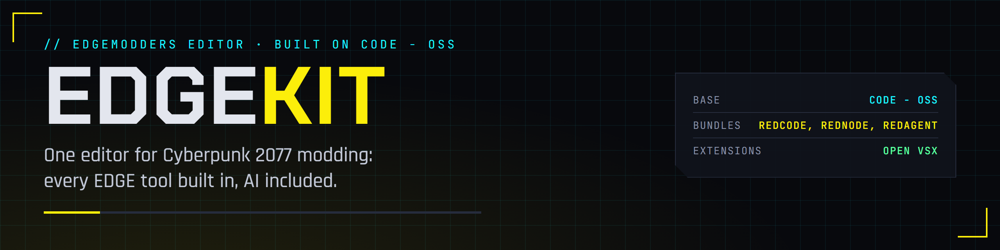

  

  
  
  
  
  

The EDGEmodders editor: a build of Code - OSS, the open-source core of VS Code, with EDGEmodders branding and every EDGE tool built in. Install one app and get [REDcode](https://github.com/Edgemodders/REDcode)'s editors, [REDnode](https://github.com/Edgemodders/REDnode)'s views and HUD theme, and [REDagent](https://github.com/Edgemodders/REDagent), with extensions from [Open VSX](https://open-vsx.org/).

**[Read the docs](https://edgemodders.github.io/EDGEkit/)** &middot; [Design](docs/design.md) &middot; [Dev setup](docs/dev-setup.md)

> [!NOTE]
> **Status: scaffold.** The plan, the branding and draft build scripts exist; nothing is built yet. Next: K0, decisions with the user, then K1, building Code - OSS on the dev PC.

## How it is built

Nothing from upstream is committed. `tools/` fetches Code - OSS at the release pinned in `upstream.json`, merges `product/product.json` (names, ids, Open VSX) into it, unpacks the extensions listed in `extensions.json` from the sibling repos, and runs upstream's Windows build.

| File | What it is |
|---|---|
| `upstream.json` | The Code - OSS release to build on |
| `product/product.json` | EDGEkit's branding, merged over upstream's `product.json` |
| `extensions.json` | The extensions built in, and where each comes from |
| `tools/build.ps1` | Fetch, brand, bundle, build. A draft until phase K1 |
| `tools/brand/` | Renders the banner, icon and badges |

EDGEkit is not affiliated with Microsoft, CD Projekt RED or Anthropic. Visual Studio Code is a trademark of Microsoft; EDGEkit is built from the MIT-licensed Code - OSS and does not use the Visual Studio Code name or logo.
